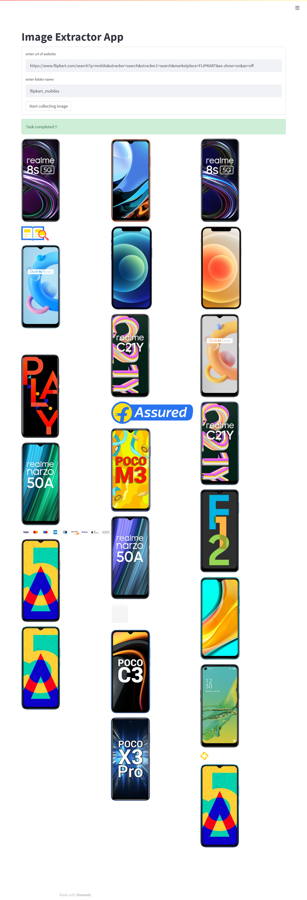

# Image-Extractor-App

Simple Image extractor program using Scraping and Streamlit.



## Table of Contents
- [Introduction](#introduction)
- [Features](#features)
- [Installation](#installation)
- [Usage](#usage)
- [Contributing](#contributing)
- [License](#license)

## Introduction
Image-Extractor-App is a Python-based tool designed to scrape images from websites and display them using Streamlit. The application leverages BeautifulSoup for web scraping and provides a user-friendly interface through Streamlit.

## Features
- Scrape images from any website.
- Download scraped images to a local directory.
- Display images using Streamlit.
- Progress bar for tracking download progress.
- Validates and handles image URLs effectively.

## Installation
To get started with Image-Extractor-App, follow these steps:

1. **Clone the repository:**
   ```sh
   git clone https://github.com/zaid-kamil/Image-Extractor-App.git
   cd Image-Extractor-App
   ```

2. **Install the required dependencies:**
   ```sh
   pip install -r requirements.txt
   ```

## Usage
1. **Run the Streamlit application:**
   ```sh
   streamlit run image_extractor.py
   ```

2. **Enter the URL of the website from which you want to extract images.**

3. **Click the button to start scraping and downloading images.**

4. **Check the specified directory for downloaded images.**

### Example
Here's a brief example of how to use the main functions in the script:

```python
from image_extractor import get_all_images, download

# Example URL
url = "https://example.com"

# Get all image URLs
image_urls = get_all_images(url)

# Download images to the 'images' directory
for img_url in image_urls:
    download(img_url, "images")
```

## Contributing
Contributions are welcome! If you have suggestions or improvements, feel free to open an issue or submit a pull request.
